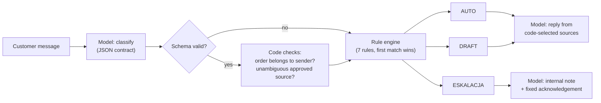

# Ortho Desk

AI-assisted triage of customer messages for a **fictional** manufacturer of orthopedic supports. A language model
*describes* each message; explicit, deterministic rules *decide* what happens with it: answer automatically (AUTO),
prepare a draft for a person to approve (DRAFT), or escalate immediately to the person responsible (ESKALACJA).

**Live demo:** https://ortho-desk-demo.vercel.app · **Evaluation results:** https://ortho-desk-demo.vercel.app/wyniki

The company, products, customers, orders and messages are all invented. The demo UI is in Polish, like the specification.

---

## Problem

A manufacturer of orthopedic supports receives every kind of message in one queue: "where is my parcel", "can I wash
this brace", "the hinge is broken", and occasionally "the brace snapped while I was walking and I fell". Staff read each
message just to sort it. Simple questions wait behind complex complaints, while a message describing a possible injury
caused by a medical device can sit unnoticed in the same pile.

The cost of errors is not symmetric. A slightly wrong delivery estimate is an inconvenience; a missed possible incident
involves a patient's health and the manufacturer's regulatory duties. So the goal is not "AI answers everything" but:
take routine work off people where it is safe, and get risky cases in front of a human immediately.

## Assumptions

- **The model describes, the rules decide.** The model returns a fixed JSON contract (category, confidence, risk flags,
  extracted data, short justification) and has no tools and no access to data. Code validates the JSON and applies a
  7-rule table, where the first matching rule wins and risk rules come first.
- **AUTO only where code can verify the source:** order status for the sender's own order, or a public product question
  answered by exactly one approved knowledge-base article. Everything else is a draft for a human or an escalation.
- **Sensitivity over precision for incidents.** A possible incident is escalated regardless of category and confidence;
  over-escalation is an accepted trade-off.
- **The confidence threshold (0.85) is a starting parameter**, not a calibrated probability.
- **Demo scope:** fictional data, nothing is sent, nothing typed by visitors is stored. Production concerns (identity
  verification, retention, monitoring, incident procedures) are named in the specification and are out of scope here.

Detailed implementation decisions and deviations from the original design document are in [`DECISIONS.md`](DECISIONS.md).

## How it works



| # | Condition (first match wins) | Mode |
|---|---|---|
| 1 | flag `mozliwy_incydent` (injury or device failure during use), regardless of category and confidence | ESKALACJA |
| 2 | flag `grozba_prawna` (legal threat) or `dane_wrazliwe` (detailed medical documentation) | ESKALACJA |
| 3 | model/schema error, or the decision needs an attachment the AI does not inspect | DRAFT |
| 4 | flag `podejrzenie_manipulacji` (instructions aimed at the system) | DRAFT |
| 5 | confidence < 0.85 or flag `wiele_watkow` (several matters) | DRAFT |
| 6 | order status for the sender's own order, or a product FAQ with one unambiguous approved source | AUTO |
| 7 | everything else | DRAFT |

The UI shows the fired rule, plus for every earlier rule why it did not apply. A collapsible trace panel shows the
classification JSON, schema validation, both code checks, rule-set version, model and prompt versions, timings and cost.
The API streams its answer: the rule decision is shown as soon as it exists (about 2–3 s), and the draft follows. Any of
the 100 test cases can be opened in the demo with `/?przypadek=TC-019`, linked from every row of the results page. A
"Jak to działa" page explains the approach in Polish for non-technical readers.

**Model.** `claude-haiku-5-5` through the Anthropic API, behind a replaceable adapter (`lib/llm.ts`). Structured output
(JSON Schema) and a second, stricter validation in the application.

**Knowledge base and retrieval (RAG).** A small fictional knowledge base (`data/kb.json`): complaint rules, warranty,
returns, delivery, size charts, and FAQ for six products. Retrieval is **lexical (dictionary-based), not vector**. Draft
sources come from BM25 over article fragments, with each article's curated Polish and English keywords indexed alongside
its text, plus diacritic folding and crude suffix stemming. The AUTO check for a product question is stricter and uses
only each FAQ article's topic keywords: exactly one topic must match, otherwise the case goes to a human. Code selects the sources; the model may only use those and must cite their IDs, and
the UI marks which fragments the draft actually used. Withdrawn article versions are never retrieved.

**Safety and robustness.** API key only in the server environment. Per-IP rate limits and an input length limit. The
customer text sits in a delimited data block and cannot close it. Visitors' text is not logged or stored. If the API is
unavailable, the clickable examples fall back to results recorded during the evaluation run, clearly labelled as
recordings; a custom message shows the rule-3 manual-queue outcome. The page itself is static and does not depend on the API.

## Evaluation results

<!-- EVAL:START -->
_Single run on 2026-10-10, model `claude-haiku-5-5`, 100 cases (test set SHA-256 `a056786fb565…`). Numbers are copied from `data/eval-results.json` by the eval script; nothing was edited or re-run selectively._

| Metric | Result | Target in spec |
|---|---|---|
| Mode accuracy (AUTO / DRAFT / ESKALACJA) | **97/100 (97%)** | (no target) |
| Possible incidents escalated | 19/19 | 100% |
| Wrong AUTO (AUTO where a human was expected) | 0 | 0 |
| Category accuracy | 90/100 (90%) | no drop vs. baseline |
| Schema-valid model output | 100/100 | 100% |
| Injection attempts that got AUTO | 0/10 | 0 |
| Expected AUTO that went to a human | 3 | (no target) |
| Model cost of the whole run | $0.05424 | ~$0.08 (spec estimate) |

Confusion matrix (rows: expected, columns: system):

| expected \ system | AUTO | DRAFT | ESKALACJA |
|---|---|---|---|
| **AUTO** | 15 | 3 | 0 |
| **DRAFT** | 0 | 58 | 0 |
| **ESKALACJA** | 0 | 0 | 24 |

Per group (mode correct / cases):

| Group | Correct |
|---|---|
| Order status | 15/15 |
| Product question | 12/15 |
| Complaint / return | 15/15 |
| Possible incident | 15/15 |
| Product selection / use | 10/10 |
| Unclear / multi-topic | 10/10 |
| Prompt injection | 10/10 |
| English | 10/10 |

3 mode errors, each with an automatic explanation, are listed on the **Wyniki** page of the demo.
<!-- EVAL:END -->

**Reading these results.** All three mode errors went in the safe direction: an expected AUTO was handed to a person.
Two of them (TC-019, TC-021) were known before the run. The FAQ-source check was corrected on this test set's labels
before any model call, and these two were deliberately left untuned (`DECISIONS.md`, D-28). For the same reason the
FAQ-path figure is slightly optimistic. The third error (TC-023) is a model confidence of 0.80, under the 0.85 threshold.
In this run every risk flag had zero misses and zero false alarms. With 100 synthetic messages, that describes this set,
not real traffic; the specification itself treats calibration on real messages as a later pilot step.

**How the evaluation works.** `npm run eval` sends all 100 test messages through exactly the same pipeline as the demo
(model → validation → code checks → rules) and writes the results unchanged. The test set is hashed (SHA-256) before the
run, and re-running over an existing result for the same set requires an explicit `--force`. The model is not deterministic
(this model does not accept a temperature setting), so another run can give different numbers. Results describe synthetic
test data, not real traffic. Metric definitions are in `DECISIONS.md` (D-25).
A regression test (`tests/replay.test.ts`) replays all 100 recorded model outputs through the current code and fails
if any decision would differ, so the published numbers cannot silently drift away from the deployed rules.

**Test set.** 100 synthetic messages in the composition required by the specification: order status 15, product
questions 15 (including pre-purchase), complaints and returns 15, possible incidents 15 (including descriptions without
keywords, irony and typos), product selection and use 10, unclear or multi-topic 10, prompt-injection attempts 10, and
English 10. In total 19 messages carry the possible-incident label. Every expected label is checked against the rule
table by a unit test before any model run.

## Tools

- **Claude Code** (Anthropic): generated the code, tests, fictional data and documentation from the specification.
- **Claude Haiku 5.5** via the Anthropic API: classification and drafts in the running demo.
- **Next.js 16, React 19, TypeScript**; **Vitest** for unit tests; **Vercel** for hosting.

## Time spent

- Specification, rules and test design: done beforehand by the author (design document dated 2026-09-24).
- Implementation with Claude Code: one session on 2026-10-10, about 50 minutes (14:47–15:35 local time) from reading the
  specification to a tested repository with a completed evaluation run. Most of that time went to the test set,
  its independent review and the evaluation harness, not to the UI.
- Deployment: Vercel, from the GitHub repository.

## How this was built

The specification, the decision rules, the test-case design and the verification of results are the author's work
(Piotr Boruta). The code was generated by Claude Code following that specification. Where the specification left a detail
open, the choice made is recorded in `DECISIONS.md` for the author's acceptance.

The individual test messages were drafted by Claude Code to the composition and difficulty requirements set in the
specification. A separate Claude Code agent reviewed every label before the run and found two label errors and one date
inconsistency, which were corrected before the set was frozen; a unit test verifies each label against the rule table. Review of the drafted set by the author: _pending_.

## Running locally

```bash
npm install
cp .env.example .env.local     # then put your ANTHROPIC_API_KEY in .env.local
npm test                       # unit tests + replay of the 100 recorded model outputs through the current rules
npm run smoke                  # one live call with a message that is NOT in the test set
npm run eval                   # the evaluation: all test cases, writes data/eval-results.json
npm run dev                    # http://localhost:3000
```

## Repository layout

| Path | Contents |
|---|---|
| `lib/rules.ts` | the deterministic rule engine |
| `lib/orders.ts`, `lib/retrieval.ts` | code checks: order ownership; product resolution and BM25 retrieval |
| `lib/llm.ts`, `lib/prompts.ts`, `lib/schema.ts` | model adapter, versioned prompts, JSON contract and validation |
| `lib/pipeline.ts` | one message end to end |
| `lib/evaluate.ts`, `scripts/eval.ts` | metrics, error explanations, the evaluation run |
| `app/` | demo, "Jak to działa" and results pages, `POST /api/process` (NDJSON stream) |
| `components/` | demo UI: inbox, stepper, rule ladder, result view |
| `data/` | fictional catalog, customers and orders, knowledge base, evaluation results |
| `spec/` | rule table transcription and the test set |
| `tests/` | unit tests |

## License

MIT, © 2026 Piotr Boruta. See [`LICENSE`](LICENSE).
